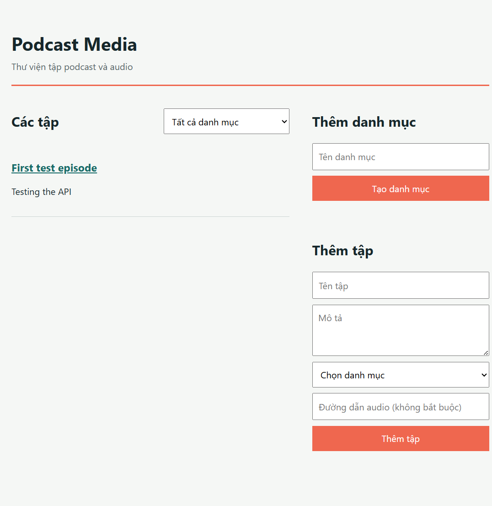
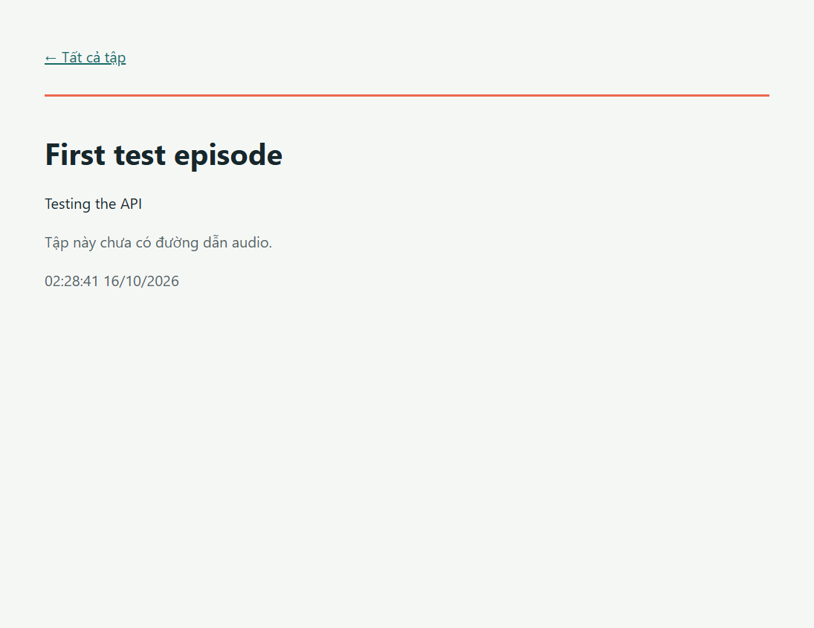
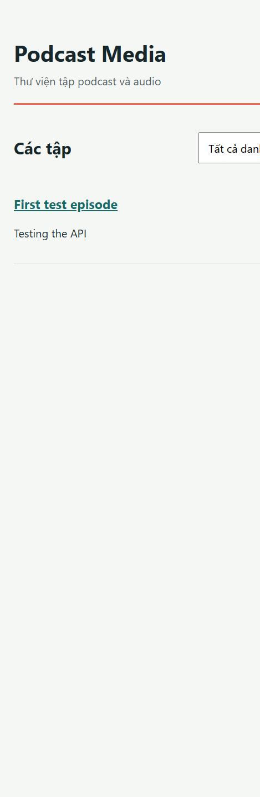
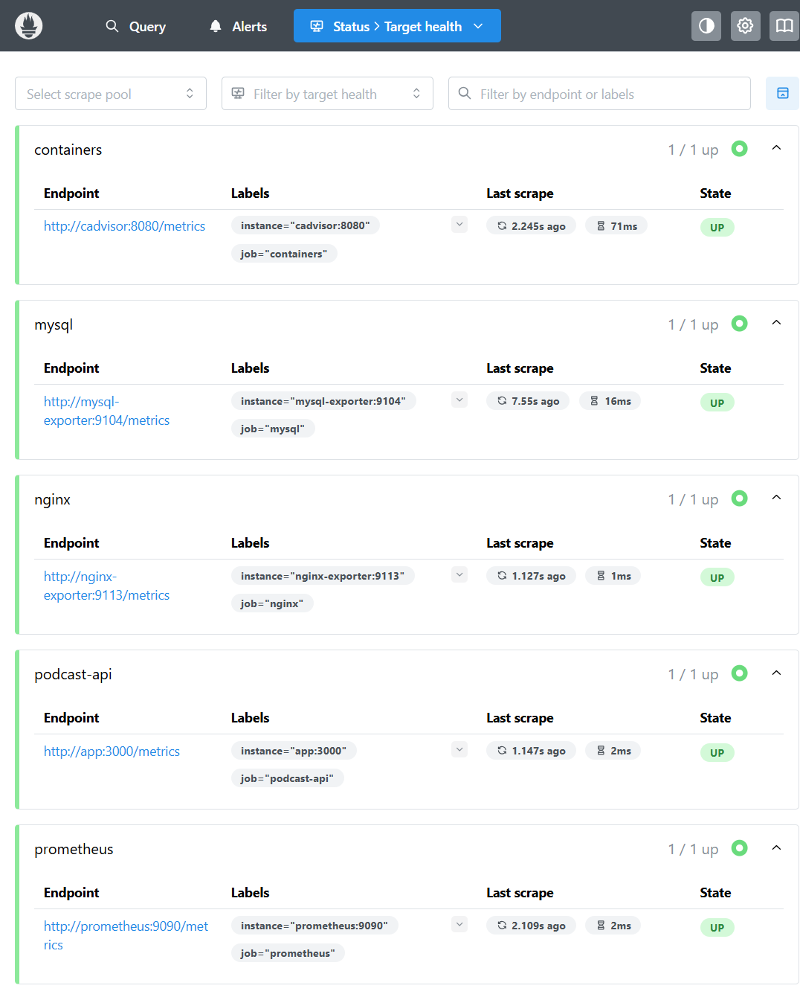
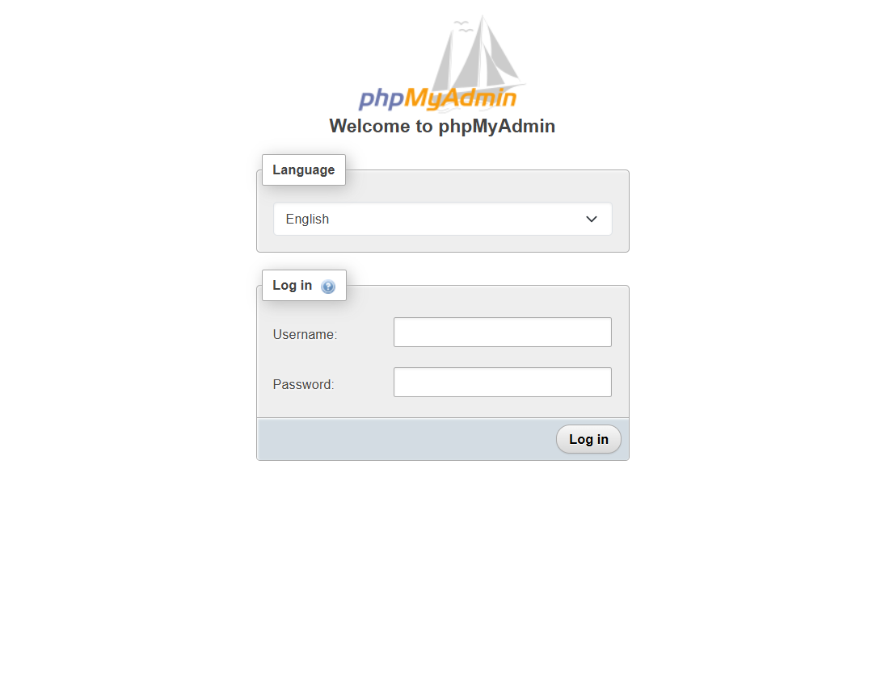

# Podcast Media

Website Podcast/Media Library dùng Express, MySQL và Docker Compose. Nginx làm reverse proxy; Prometheus/Grafana thu thập và hiển thị metrics; Loki/Promtail tập trung log.

## Yêu cầu

- Docker Desktop đang chạy ở chế độ Linux containers
- Docker Compose v2

## Cấu hình môi trường

Sao chép `.env.example` thành `.env`, sau đó thay các giá trị mẫu bằng mật khẩu riêng, mạnh và không dùng lại giữa các dịch vụ. Không commit `.env` lên GitHub.

## Khởi chạy

Chạy tại thư mục gốc:

```powershell
docker compose config --quiet
docker compose up -d --build
docker compose ps
```

Ứng dụng tự tạo bảng `categories` và quan hệ `episode_categories` khi khởi động. Dữ liệu được giữ trong named volumes.

## Dịch vụ

| Dịch vụ               | Địa chỉ từ máy local |

| Website/API qua Nginx | <http://localhost:8080> |
| phpMyAdmin            | <http://localhost:8081> |
| Prometheus            | <http://localhost:9090> |
| Grafana               | <http://localhost:3001> |
| Loki readiness        | <http://localhost:3100/ready> |

MySQL, Express và các exporter chỉ truy cập nội bộ qua Docker networks; không publish cổng MySQL/API trực tiếp ra host. phpMyAdmin đăng nhập bằng host `db` và tài khoản `MYSQL_USER`/`MYSQL_PASSWORD`. Grafana dùng user `admin` và `GRAFANA_ADMIN_PASSWORD`.

## API

| Method| Endpoint             | Chức năng |

| GET   | `/health`             | Kiểm tra API |
| GET   | `/health/db`          | Kiểm tra kết nối MySQL |
| GET   | `/api/categories`     | Liệt kê danh mục |
| POST  | `/api/categories`     | Tạo danh mục với JSON `{"name":"Công nghệ"}` |
| GET   | `/api/episodes`       | Liệt kê tập và danh mục |
| GET   | `/api/episodes/:id`   | Chi tiết tập |
| POST  | `/api/episodes`       | Tạo tập; nhận `title`, `description`, `audio_url`, `category_id` |
| GET   | `/metrics`            | Metrics cho Prometheus |

Audio preview dùng URL audio trực tiếp, ví dụ MP3/stream URL truy cập được từ trình duyệt. Tạo tập mẫu:

```powershell
Invoke-RestMethod -Method Post -Uri 'http://localhost:8080/api/episodes' -ContentType 'application/json' -Body '{"title":"Demo episode","description":"Example","category_id":1,"audio_url":"https://example.com/audio.mp3"}'
```

## Monitoring và logs

Prometheus scrape các target `podcast-api`, `nginx`, `mysql`, `containers` và `prometheus`; Grafana tự provision data sources cùng dashboard **Podcast Observability**.

PromQL mẫu:

```promql
sum by (route, status_code) (rate(http_requests_total{route!="/metrics"}[5m]))
container_memory_working_set_bytes
mysql_global_status_threads_connected
nginx_connections_active
```

Grafana Explore chọn Loki datasource. LogQL mẫu:

```logql
{job="docker"}
{job="docker"} |= "GET /api/episodes"
{job="docker"} |= "level=error" != "logger=tsdb.loki"
```

Promtail được dùng để đáp ứng yêu cầu môn học. Lưu ý Promtail đã hết vòng đời hỗ trợ; chỉ dùng stack này cho môi trường local/lab. Docker socket và cAdvisor privileged đều có quyền host rộng, không expose chúng ra Internet.

## Hardening hiện có

- App chạy bằng user `node`, filesystem read-only, drop Linux capabilities và `no-new-privileges`.
- Nginx dùng image unprivileged, security headers và tắt `server_tokens`.
- Network `backend` được đánh dấu internal; MySQL không publish cổng ra host.
- phpMyAdmin, Prometheus, Grafana và Loki chỉ bind `127.0.0.1`.
- Exporter dùng account MySQL riêng chỉ có quyền đọc/giám sát cần thiết.

cAdvisor cần quyền cao để đọc metrics container; Promtail cần Docker socket. Giữ chúng trong máy lab, không dùng cấu hình này làm public production deployment.

## GitHub

Tạo repository GitHub với tên theo mã sinh viên. Thay `YOUR_STUDENT_ID` bằng mã sinh viên của bạn rồi chạy tại thư mục gốc:

```powershell
git add .
git commit -m "Build podcast media deployment and monitoring stack"
git remote add origin https://github.com/YOUR_STUDENT_ID/podcast-media.git
git push -u origin main
```

## Minh chứng

### Website và danh mục



### Trang chi tiết tập



### Bố cục điện thoại



### Prometheus targets



### phpMyAdmin



Trước khi nộp, bổ sung ảnh Grafana dashboard, phpMyAdmin đã đăng nhập, và truy vấn LogQL đang trả về log container.

## Dừng dịch vụ

```powershell
docker compose down
```

Lệnh trên giữ named volumes. Không thêm `-v` nếu cần giữ dữ liệu MySQL/Grafana/Loki/Prometheus.
